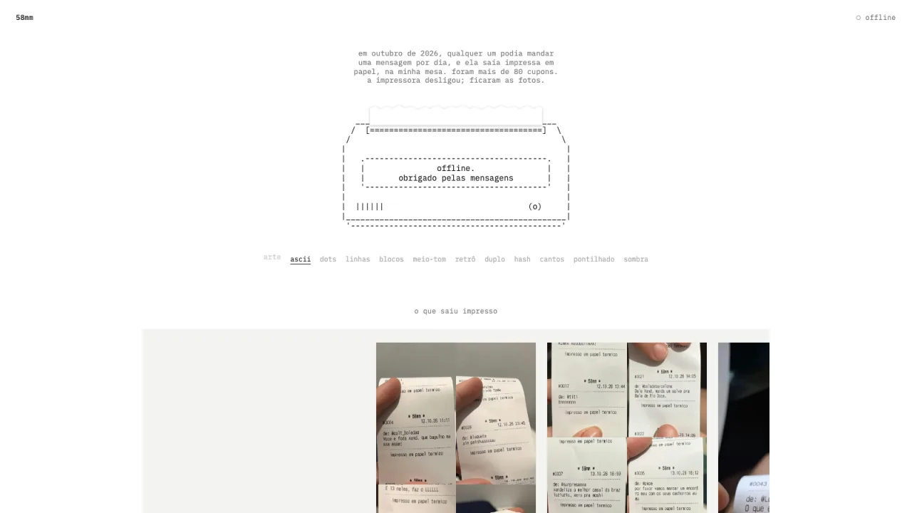
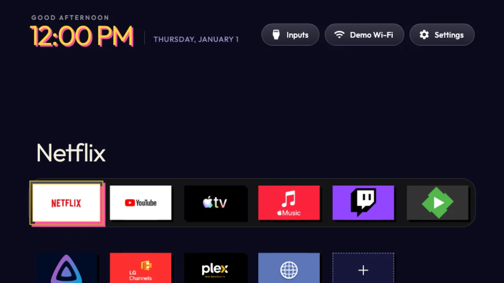
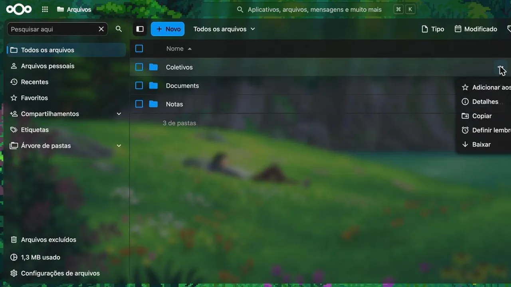

<a href="https://alexandre-projects.com.br">
  
</a>

<p>
  <a href="https://alexandre-projects.com.br"></a>
  
  
</p>

```console
$ whoami
alexandre — desenvolvedor full stack pleno

$ cat sobre.txt
Pagamentos, modelagem de dados e microsserviços no trabalho.
Impressora térmica, TV com webOS e temas em CSS no tempo livre.
Sempre com intuito de aprender e, consequentemente, me divertir.
```

## ● Projetos

<table>
  <tr>
    <td width="33%" valign="top">
      <a href="https://thermal-printer.alexandre-projects.com.br"></a>
      <p><code>01</code> <b><a href="https://github.com/xandymelo/thermal-printer">thermal-printer</a></b></p>
      <sub>Qualquer um mandava uma mensagem por dia e ela saía impressa em papel térmico, na minha mesa. Hoje é o arquivo das fotos dos cupons.</sub>
      <p><sub><code>Angular</code> <code>Node.js</code> <code>Cloudflare</code> <code>Hardware</code></sub></p>
    </td>
    <td width="33%" valign="top">
      <a href="https://github.com/xandymelo/clean-your-tv-lg-retro-theme"></a>
      <p><code>02</code> <b><a href="https://github.com/xandymelo/clean-your-tv-lg-retro-theme">clean-your-tv-lg-retro-theme</a></b></p>
      <sub>Um tema retrô pro Clean Your TV, o launcher que roda na minha TV LG com webOS: cards quadrados, sombras duras, grade azul-noite e destaque amarelo.</sub>
      <p><sub><code>CSS</code> <code>webOS</code> <code>LG TV</code></sub></p>
    </td>
    <td width="33%" valign="top">
      <a href="https://gist.github.com/xandymelo/a3e69e85d55492a5531eb744c8606e93"></a>
      <p><code>03</code> <b><a href="https://gist.github.com/xandymelo/a3e69e85d55492a5531eb744c8606e93">nextcloud-glass</a></b></p>
      <sub>Um tema de vidro fosco pro Nextcloud, só em CSS: navegação, arquivos, menus, busca, modais e login translúcidos, no claro e no escuro.</sub>
      <p><sub><code>CSS</code> <code>Nextcloud</code></sub></p>
    </td>
  </tr>
</table>

<sub>Mais coisas em <a href="https://github.com/xandymelo?tab=repositories">todos os repositórios →</a></sub>

## ● Trajetória

| Quando | Onde | O quê |
| :-- | :-- | :-- |
| 2024 — **agora** | **Serasa Experian** | Full Stack Pleno · gateways de pagamento, recorrência e estorno parcial, microsserviços. Antes, como Jr, bundle 10× menor no upgrade de framework. |
| 2022 — 2024 | **FAST — Soluções Tecnológicas** | Full Stack Jr · portal administrativo e plataforma de cursos (Angular + .NET), cálculo de CO₂ evitado do [Comida Invisível](https://app.comidainvisivel.com.br/). |
| 2021 — 2022 | **Accenture Brasil** | Consultor ABAP · telas SAP para ICMS, IPI, PIS e COFINS. |

## ● Stack

<p>
  
  
  
  
  
  
  
  
  
</p>

---

<sub>● O portfólio tem três temas — clássico, pixel e terminal ASCII. Este perfil veste o clássico; os outros estão em <a href="https://alexandre-projects.com.br">alexandre-projects.com.br</a>.</sub>
